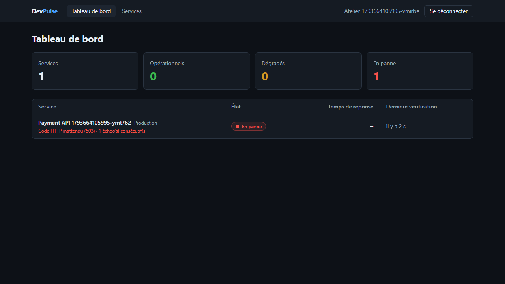

# DevPulse : surveillance de services et gestion d'incidents

Plateforme multi-organisations d'observabilité, en microservices **ASP.NET Core 10** et **Vue 3**.
Ce dépôt contient aujourd'hui le **socle et le premier parcours complet** : une organisation enregistre une API, DevPulse la surveille et affiche son état. Les incidents, les alertes et l'analyse IA ne sont pas encore écrits (voir [l'avancement](#avancement)).



## Ce qui est vérifié, et ce qui ne l'est pas

| Élément | Vérifié | Pas vérifié |
|---|---|---|
| Parcours complet | Test Playwright dans un vrai Chromium, à travers la passerelle et tous les services : inscription, ajout d'une API, états Opérationnel, Dégradé, En panne, retour à la normale | Une cible réelle sur Internet : la démonstration surveille une fausse API locale |
| Isolation entre organisations | Tests d'API sur PostgreSQL réel et test navigateur : une ressource d'une autre organisation répond 404, en lecture, modification et suppression. Retirer le filtre d'organisation fait échouer les tests (essayé sur Registry et Monitoring) | Audit de sécurité externe |
| Protection SSRF | Écritures détournées refusées (`2130706433`, `0x7f.0.0.1`, `[::ffff:7f00:1]`, `//169.254.169.254`…) ; à la connexion, une adresse interne n'est jamais contactée. Retirer ce contrôle fait échouer le test | Un vrai DNS rebinding : le contrôle est testé avec `localhost`, qui résout réellement vers une adresse interne, pas avec un serveur DNS piégé |
| Réservation des vérifications | 8 workers en parallèle sur 200 cibles : aucune cible prise deux fois (PostgreSQL réel) | Plusieurs processus workers réellement lancés ; montée en charge |
| Passerelle | 17 tests : routage, 401 sans jeton, route interne non exposée, en-têtes de sécurité, identifiant de corrélation | Le dépassement de la limite de débit |
| Télémétrie | Le collecteur OpenTelemetry reçoit traces, journaux et métriques des services en local | Il ne stocke rien (exportateur `debug`) : pas de tableau de bord technique |
| CI (GitHub Actions) | **Fichier écrit, jamais exécuté** : le dépôt n'est pas encore sur GitHub | Tout |
| Images Docker des services | **Non écrites** : les services tournent avec `dotnet` sur le poste. `docker compose` ne lance que l'infrastructure | Tout |
| Cloud, Terraform, RabbitMQ applicatif, Redis applicatif | **Rien** : RabbitMQ et Redis tournent, aucun service ne s'en sert encore | Tout |

## Architecture actuelle

```
 Vue 3 (5173) ──► Passerelle YARP (8080) ──┬─► Identity (5010) ──► devpulse_identity
                  jeton, limite de débit,  ├─► Registry (5011) ──► devpulse_registry
                  en-têtes, corrélation    └─► Monitoring API (5012) ──┐
                                                                       ▼
 API surveillées ◄── sondes HTTP ── Monitoring Worker ──────► devpulse_monitoring
                                         └── GET /internal/services/active ──► Registry
```

- **Une base par service** : Monitoring garde sa propre copie des services à surveiller, et continue si Registry tombe.
- **Le worker planifie sans appeler** : il réserve les cibles dues (`FOR UPDATE SKIP LOCKED`), les met dans une file bornée, et un nombre fixe de sondes la consomme. Si les cibles répondent lentement, le retard s'accumule en base, pas en mémoire.
- **Jetons RS256** : seul Identity a la clé privée. Un service compromis peut lire un jeton, pas en forger un ([ADR-010](docs/adr/README.md)).
- **Fermé par défaut** : toute route exige un jeton rattaché à une organisation, sauf `[AllowAnonymous]` explicite.

Décisions : [`docs/adr`](docs/adr/README.md). Événements : [`docs/events`](docs/events/README.md). Corrections apportées au cahier des charges initial : [`docs/architecture/ecarts-blueprint.md`](docs/architecture/ecarts-blueprint.md).

## Démarrer

Prérequis : Docker, SDK .NET 10, Node 24 ou plus, PowerShell 7.

```bash
pwsh infrastructure/scripts/make-env.ps1     # .env avec des secrets aléatoires (ignoré par Git)
docker compose up -d --wait                  # PostgreSQL, RabbitMQ, Redis, collecteur OpenTelemetry
pwsh infrastructure/scripts/dev.ps1          # compile et lance les services (journaux dans .run/)
```

```bash
cd apps/web/devpulse-web
npm ci
npm run dev                                  # http://localhost:5173
```

Pour voir un changement d'état : créer un compte, ajouter un service d'URL `http://localhost:5020` (fausse API de démonstration), puis :

```bash
curl -X POST http://localhost:5020/mode/down    # ou slow, ok
```

La vérification suivante arrive sous 30 s (intervalle minimal). Swagger de chaque API : `http://localhost:5010/swagger`, `5011`, `5012`. Arrêt : `pwsh infrastructure/scripts/dev.ps1 -Stop`.

`ALLOW_PRIVATE_TARGETS=true` dans `.env` autorise les cibles locales, pour la démonstration. **Il doit rester à `false` partout ailleurs.**

## Tests

```bash
dotnet test                        # 131 tests ; Docker nécessaire (PostgreSQL réel, données en mémoire)
cd apps/web/devpulse-web && npm test
cd tests/DevPulse.E2ETests && npm ci && npx playwright test    # services démarrés ; environ 2 minutes
```

| Suite | Tests | Ce qu'elle couvre |
|---|---|---|
| `DevPulse.Identity.Tests` | 10 | inscription, connexion, verrouillage après 5 échecs, jeton RS256 |
| `DevPulse.Registry.Tests` | 64 | catalogue, isolation, rôles, politique SSRF |
| `DevPulse.Monitoring.Tests` | 24 | sondes sur un vrai serveur HTTP, réservation concurrente, métriques, purge |
| `DevPulse.IntegrationTests` | 17 | passerelle devant de faux services |
| `DevPulse.ArchitectureTests` | 16 | dépendances entre couches, format des événements |
| Vitest (`devpulse-web`) | 22 | session, formats, composant d'état |
| Playwright (`DevPulse.E2ETests`) | 4 | les parcours ci-dessus, dans un navigateur |

Non testés automatiquement : les services d'arrière-plan du worker (planificateur, synchronisation, purge), exercés seulement par le test Playwright ou par leurs dépendances ; le graphique, seulement vérifié visible.

## Avancement

Par rapport aux 12 semaines du cahier des charges :

| Phase | État |
|---|---|
| 1. Fondations (monorepo, Compose, PostgreSQL, RabbitMQ, CI) | Fait, sauf CI non exécutée |
| 2. Identity et Registry | En grande partie : **restent** les jetons de renouvellement, les invitations, le changement d'organisation |
| 3. Moteur de monitoring | En grande partie : **restent** les événements RabbitMQ et l'outbox |
| 4. Incidents et alertes | Pas commencé |
| 5. Analytique et IA | Disponibilité, moyenne et P95 seulement |
| 6. Industrialisation (images, Terraform, cloud, tests de charge) | Pas commencé |
| Agent de collecte (monitoring hybride) | Pas commencé |

## Pièges rencontrés

- **`*` dans une liaison AMQP vaut un seul mot.** Le cahier des charges liait `monitoring.service.*` à des clés en quatre segments (`monitoring.service.down-detected.v1`) : la file n'aurait jamais rien reçu, sans aucune erreur. Un test le fixe.
- **Testcontainers remplit le disque.** Chaque base de test écrivait dans `docker_data.vhdx`, qui ne rétrécit jamais seul : environ 1 Go perdu en quelques exécutions sur un poste à 3 Go libres. Les données sont maintenant en mémoire (`tmpfs`), et la suite Registry est passée de 31 à 11 s.
- **Port 5432 refusé par Windows**, sans processus visible ni plage réservée listée ; la cause n'est pas établie. Le port publié se règle dans `.env` (5433 par défaut).
- **La passerelle ne démarrait pas** : `MapHealthChecks` sans `AddHealthChecks`. Trouvé par ses tests, pas à l'exécution.
- **Les refus métier remplissaient les journaux** : une URL refusée (400) était journalisée comme erreur non gérée, avec sa pile d'appels. Trouvé en relisant les journaux après le test navigateur.
- **Serilog et le journal par défaut** écrivaient chaque ligne deux fois, en JSON et en texte, à cause de `writeToProviders`.
- **EF Core en deux versions** : Npgsql tire la 10.0.4, le projet la 10.0.14. L'épinglage transitif de la gestion centrale des paquets règle le conflit.

## Limites

- **La session dure 15 minutes** : pas de jeton de renouvellement, il faut se reconnecter. Le jeton est dans `sessionStorage`.
- **Un utilisateur n'a qu'une organisation en pratique** : le modèle en permet plusieurs, mais ni invitation ni changement d'organisation n'existent.
- **Le temps réel est une interrogation toutes les 5 s**, pas encore SignalR.
- **Le seuil « dégradé » est fixe** (1 s), et les vérifications partent d'un seul point : une coupure réseau côté DevPulse ressemblerait à une panne de la cible.
- **Le calcul des métriques se fait en mémoire**, sur toutes les vérifications de la période : acceptable sur 7 jours de rétention, pas au-delà. Pas d'agrégats horaires ni de TimescaleDB.
- **La limite de débit est en mémoire**, par adresse de connexion : elle ne vaut que pour une instance de passerelle, et verrait l'adresse du répartiteur derrière un ALB.
- **Le compte se verrouille après 5 échecs** : un attaquant qui connaît une adresse peut bloquer ce compte 15 minutes.
- **Les traces contiennent une requête SQL par seconde** (réservation du worker), sans filtre pour l'instant.
- Aucune mesure de performance n'a été faite : les objectifs du cahier des charges (notification sous 10 s, etc.) restent à valider.

## Structure

```
src/Services/{Identity,Registry,Monitoring}/   Api, Application, Domain, Infrastructure, Tests (+ Worker)
src/Gateway/DevPulse.Gateway/                  passerelle YARP
src/BuildingBlocks/                            Contracts, Security (JWT, SSRF), Observability
apps/web/devpulse-web/                         Vue 3, TypeScript, Pinia, TanStack Query, ECharts
infrastructure/docker/                         initialisation PostgreSQL, configuration du collecteur
infrastructure/scripts/                        make-env.ps1, dev.ps1
infrastructure/demo/DevPulse.DemoTarget/       fausse API à surveiller
tests/                                         architecture, passerelle, parcours navigateur
docs/                                          ADR, événements, écarts avec le cahier des charges
```

## Licence

Projet personnel, sans licence explicite pour l'instant.
