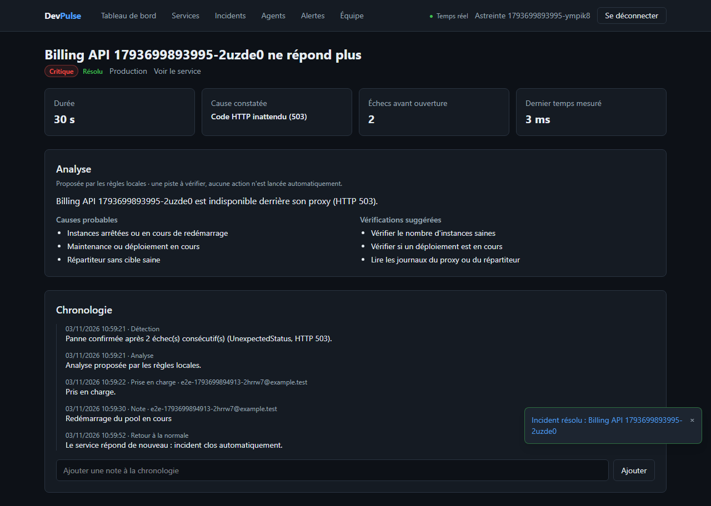

# DevPulse : surveillance de services et gestion d'incidents

Plateforme multi-organisations d'observabilité, en microservices **ASP.NET Core 10** et **Vue 3**. Une équipe enregistre ses API, DevPulse les sonde (ou reçoit les battements d'un agent installé chez elle), ouvre un incident quand une panne est confirmée, prévient par webhook ou Slack, propose une analyse et ferme l'incident au retour du service.



## Ce qui est vérifié, et ce qui ne l'est pas

| Élément | Vérifié | Pas vérifié |
|---|---|---|
| Parcours complet | Playwright dans un vrai Chromium, à travers la passerelle et tous les services : panne de la fausse API → incident → webhook signé → analyse → prise en charge → fermeture automatique au retour | Une cible réelle sur Internet : la démonstration surveille une fausse API locale |
| Délai de notification (objectif < 10 s) | **73 ms** mesurés en local entre la panne confirmée et la réception du webhook ; le test échoue au-delà de 10 s, en local et en CI | La détection elle-même prend deux intervalles (deux échecs consécutifs) : 30 à 60 s avec l'intervalle minimal |
| Messagerie | Contre un vrai RabbitMQ : doublon sans effet, transaction annulée sans publication, reprise après délai, file morte, courtier injoignable. Retirer la déduplication fait échouer le test | Perte d'un nœud RabbitMQ ; un cluster |
| Isolation entre organisations | Tests d'API sur PostgreSQL réel dans chaque service, hub temps réel compris, et test navigateur. Casses volontaires détectées (filtres Registry et Monitoring, groupes SignalR) | Audit de sécurité externe |
| Sessions | Rotation du jeton de renouvellement, révocation de toute la famille en cas de rejeu, aucun jeton dans le stockage du navigateur (vérifié dans Chromium) | Rotation de la clé de signature (une seule clé RSA) |
| Protection SSRF | Sondes et webhooks : écritures détournées refusées, adresse interne jamais contactée même si elle est en base | Un vrai DNS rebinding (testé avec `localhost`, pas un DNS piégé) |
| Agent | Clé, révocation, silence détecté et incident ouvert, mesures réelles sous Windows ; sous Linux dans la CI | Un déploiement de l'agent sur une vraie flotte |
| IA | Règles locales et fournisseur compatible OpenAI (requête, réponse, repli), contre un faux serveur HTTP | **Aucun appel à un vrai modèle** : pas de clé utilisée |
| Images Docker | Construites et démarrées ensemble en CI, puis parcours navigateur et charge contre elles | Analyse de vulnérabilités des images |
| Charge | k6, 20 utilisateurs pendant 30 s, en CI : résultats dans le résumé de chaque exécution | Une machine de production ; la montée en charge du worker de sondes |
| AWS (Terraform) | `terraform validate` en CI | **Jamais appliqué** : aucun compte AWS utilisé, aucun `plan` calculé. Coût estimé dans [cout-aws.md](docs/architecture/cout-aws.md) |

## Architecture

```
 Vue 3 ──► Passerelle YARP ──┬─► Identity ─────► devpulse_identity      jetons RS256, renouvellement, équipes
           jeton, limites,   ├─► Registry ─────► devpulse_registry      catalogue des services
           corrélation       ├─► Monitoring API ─┐                      tableau de bord, agents
                             ├─► Incident ───────┼─► devpulse_incident  incidents, chronologie
                             └─► Alerting ◄──────┼─► devpulse_alerting  canaux, envois, hub SignalR
                                    ▲            ▼
 API surveillées ◄── sondes ── Monitoring Worker ──► devpulse_monitoring
 Agents ── battements HTTPS ──► Monitoring API
                                    │
                     RabbitMQ (devpulse.events, outbox des deux côtés)
   status-changed ──► Alerting (temps réel)     down-detected / recovered ──► Incident
   incident.* ──► Alerting (webhooks, Slack)    incident.created ──► Worker IA ──► ai.analysis.completed ──► Incident
```

- **Une base par service**, aucune clé étrangère entre elles. Monitoring garde sa copie des services à surveiller et continue si Registry tombe.
- **Outbox et idempotence** : un événement part avec la transaction qui le décrit ; un doublon reçu est ignoré ([ADR-009](docs/adr/README.md)).
- **Le worker planifie sans appeler** : réservation des cibles dues en base (`FOR UPDATE SKIP LOCKED`), file bornée, nombre fixe de sondes.
- **Une panne s'annonce au deuxième échec consécutif** : l'état affiché suit chaque vérification, l'incident attend la confirmation.
- **Incident ouvre l'incident, Alerting ne fait que prévenir** ([ADR-012](docs/adr/README.md)) ; le temps réel est un canal d'Alerting ([ADR-013](docs/adr/README.md)).
- **Fermé par défaut** : toute route exige un jeton rattaché à une organisation, sauf `[AllowAnonymous]` explicite.

Décisions : [`docs/adr`](docs/adr/README.md). Événements et garanties : [`docs/events`](docs/events/README.md). Corrections du cahier des charges : [`docs/architecture/ecarts-blueprint.md`](docs/architecture/ecarts-blueprint.md). Déploiement AWS : [`infrastructure/terraform`](infrastructure/terraform/README.md).

## Démarrer

Prérequis : Docker, SDK .NET 10, Node 24 ou plus, PowerShell 7.

**Tout en conteneurs** (images construites sur le poste) :

```bash
pwsh infrastructure/scripts/make-env.ps1       # .env avec des secrets aléatoires (ignoré par Git)
docker compose --profile apps up -d --build    # http://localhost:5173
```

**Pour développer** (services lancés avec `dotnet`, rechargement du front) :

```bash
docker compose up -d --wait                    # PostgreSQL, RabbitMQ, Redis, collecteur OpenTelemetry
pwsh infrastructure/scripts/dev.ps1            # compile et lance les 9 processus (journaux dans .run/)
cd apps/web/devpulse-web && npm ci && npm run dev
```

Pour voir un incident : ajouter un service d'URL `http://localhost:5020` (fausse API de démonstration ; `http://demo:8080` en conteneurs), un canal webhook vers `http://localhost:5020/webhooks/essai`, puis :

```bash
curl -X POST http://localhost:5020/mode/down    # ou slow, ok
curl http://localhost:5020/webhooks/essai       # alertes reçues, avec leur heure de réception
```

`ALLOW_PRIVATE_TARGETS=true` autorise ces adresses locales. **Il doit rester à `false` partout ailleurs.**

**Analyse par un modèle de langage** : `AI_PROVIDER=Llm`, `AI_BASE_URL` (par exemple `https://api.openai.com/v1/` ou `http://localhost:11434/v1/` pour Ollama), `AI_MODEL`, `AI_API_KEY` dans `.env`. Sans cela, les règles locales répondent.

**Agent** : créer un agent dans la page « Agents », puis sur la machine à surveiller :

```bash
DevPulse__Url=https://devpulse.example.com DevPulse__AgentKey=dpa_… dotnet DevPulse.Agent.dll
```

## Tests

```bash
dotnet test                        # 248 tests ; Docker nécessaire (PostgreSQL et RabbitMQ réels, données en mémoire)
cd apps/web/devpulse-web && npm test
cd tests/DevPulse.E2ETests && npm ci && npx playwright test    # services démarrés ; environ 4 minutes
```

| Suite | Tests | Ce qu'elle couvre |
|---|---|---|
| `DevPulse.Identity.Tests` | 20 | inscription, verrouillage, RS256, rotation et rejeu du jeton de renouvellement, invitations, rôles, dernier propriétaire |
| `DevPulse.Registry.Tests` | 64 | catalogue, isolation, rôles, politique SSRF |
| `DevPulse.Monitoring.Tests` | 37 | sondes sur un vrai serveur HTTP, réservation concurrente, annonce des pannes, agents (clé, révocation, silence) |
| `DevPulse.Incident.Tests` | 17 | ouverture, fermeture automatique, ordre des messages, analyse, rôles, isolation, statistiques |
| `DevPulse.Alerting.Tests` | 15 | signature HMAC, SSRF à l'envoi, règles par canal, reprises, clé montrée une fois, isolation du hub SignalR |
| `DevPulse.AI.Tests` | 14 | règles par type de panne, requête au modèle sans donnée d'identification, réponses rejetées, repli |
| `DevPulse.Messaging.Tests` | 15 | outbox, doublons, reprises, file morte, topologie, contre un vrai RabbitMQ |
| `DevPulse.Agent.Tests` | 5 | calcul processeur et mémoire, mesures réelles du système |
| `DevPulse.IntegrationTests` | 36 | passerelle devant de faux services : routes, 401, limite de débit dépassée (429) |
| `DevPulse.ArchitectureTests` | 25 | dépendances entre couches et services, événements tous reçus par une file |
| Vitest (`devpulse-web`) | 34 | session en mémoire, renouvellement unique pour des requêtes simultanées, formats, composants |
| Playwright (`DevPulse.E2ETests`) | 7 | parcours ci-dessus, invitation, session après rechargement, isolation |

La CI (GitHub Actions) exécute tout cela, puis construit les images, démarre la plateforme complète, rejoue les parcours Playwright et la charge k6 contre les conteneurs, et valide le Terraform.

Non testés automatiquement : les services d'arrière-plan du worker (planificateur, synchronisation, purge, surveillance des agents) autrement que par le test navigateur ou par leurs dépendances ; le graphique, seulement vérifié visible.

## Pièges rencontrés

- **`*` dans une liaison AMQP vaut un seul mot.** Le cahier des charges liait `monitoring.service.*` à des clés en quatre segments : la file n'aurait jamais rien reçu, sans aucune erreur. Un test le fixe, et un traitement déclaré pour un événement non lié empêche le service de démarrer.
- **Un test de doublon qui passait pour une mauvaise raison.** Lancé seul sur un courtier neuf, il publiait avant que les files existent : le message disparaissait, et la casse volontaire de la déduplication ne le faisait pas échouer. La fixture déclare maintenant la topologie avant chaque test.
- **Testcontainers et Docker remplissent le disque.** Le disque virtuel de Docker ne rétrécit jamais seul : bases de test en mémoire (`tmpfs`), et la construction des images se fait en CI.
- **EF Core journalise une erreur au premier démarrage d'une base neuve** (lecture de l'historique des migrations avant sa création). Bénin et unique ; laissé tel quel plutôt que de masquer les erreurs SQL.
- **Une politique de limite inconnue de la passerelle invalide toute la configuration YARP** : toutes les routes répondaient en erreur. Trouvé par les tests de la passerelle.
- **Port 5432 refusé par Windows**, sans cause établie : le port publié se règle dans `.env` (5433 par défaut).
- **Serilog et le journal par défaut** écrivaient chaque ligne deux fois ; les refus métier étaient journalisés comme des erreurs.
- **EF Core en deux versions** (Npgsql tire la 10.0.4) : épinglage transitif de la gestion centrale des paquets.

## Limites

- **Un seul point de sonde** : une coupure réseau côté DevPulse ressemblerait à une panne de la cible. Le seuil « dégradé » est fixe (1 s).
- **Pas d'e-mail** : les invitations se transmettent par lien, les alertes par webhook ou Slack.
- **La limite de débit est en mémoire**, par instance de passerelle : avec plusieurs instances, la limite effective est multipliée d'autant.
- **Le calcul des métriques se fait en mémoire** sur la période demandée : acceptable sur 7 jours de rétention, pas au-delà.
- **Le compte se verrouille après 5 échecs** : un attaquant qui connaît une adresse peut bloquer ce compte 15 minutes.
- **Une seule clé de signature** : sa rotation demande de publier plusieurs clés (JWKS).
- **Un membre retiré garde son jeton d'accès jusqu'à 15 minutes** ; ses sessions sont révoquées immédiatement.
- **Un utilisateur PostgreSQL unique** en local et dans le Terraform : un utilisateur par service serait l'étape suivante.

## Structure

```
src/Services/{Identity,Registry,Monitoring,Incident,Alerting}/   Api, Application, Domain, Infrastructure, Tests (+ Worker)
src/Services/AI/                 worker d'analyse (Application, Infrastructure, Worker, Tests)
src/Agent/DevPulse.Agent/        agent installé chez le client (Linux, Windows)
src/Gateway/DevPulse.Gateway/    passerelle YARP
src/BuildingBlocks/              Contracts, Messaging (RabbitMQ, outbox), Security (JWT, SSRF), Observability
apps/web/devpulse-web/           Vue 3, TypeScript, Pinia, TanStack Query, ECharts, SignalR
infrastructure/docker/           image .NET commune, initialisation PostgreSQL, collecteur
infrastructure/terraform/        AWS ECS Fargate, RDS, Amazon MQ, ElastiCache
infrastructure/demo/             fausse API à surveiller et boîte à webhooks
tests/                           architecture, messagerie, passerelle, agent, parcours navigateur, charge (k6)
docs/                            ADR, événements, écarts avec le cahier des charges, coût AWS
```

## Licence

Projet personnel, sans licence explicite pour l'instant.
